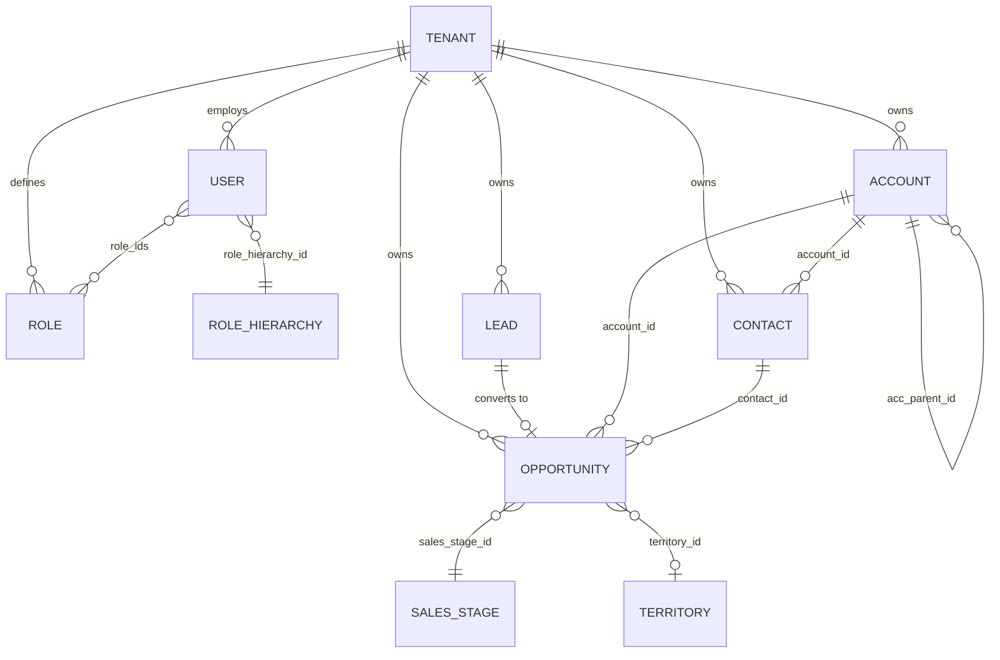
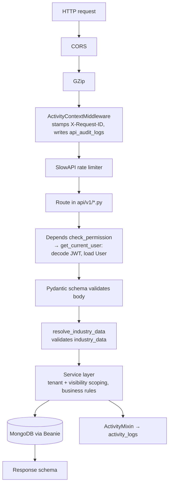
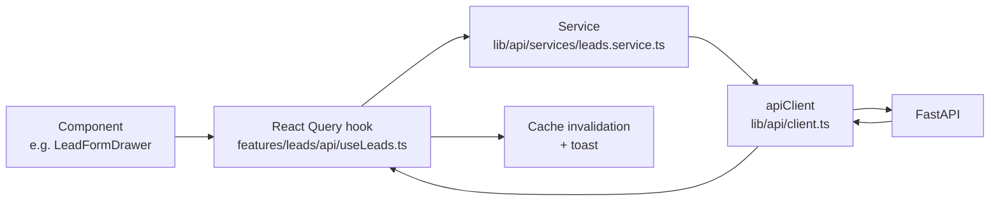

# Tutterfly CRM — Schema & Data Flow

**Onboarding guide for new engineers.** Read this end to end before writing code. It explains
what the system is, how data is shaped, and how a request travels from a click in the browser to
a document in MongoDB and back.

> **This guide links into the source files** — it assumes you have the repository checked out.
> If you don't yet, read [`SYSTEM_HANDBOOK.md`](./SYSTEM_HANDBOOK.md) instead: same material, fully
> self-contained, with every schema and code pattern reproduced inline.

Companion documents:
- [`CLAUDE.md`](../CLAUDE.md) — the non-negotiable engineering rules. **Read this too; it is enforced in review.**
- [`MULTI_INDUSTRY_ARCHITECTURE.md`](../MULTI_INDUSTRY_ARCHITECTURE.md) — why the industry layer exists.
- [`docs/CURRENT_TRAVEL_CRM_SCHEMA.md`](./CURRENT_TRAVEL_CRM_SCHEMA.md) — per-module field tables.
- [`docs/LOGGING_AND_AUDIT.md`](./LOGGING_AND_AUDIT.md) — logging and the audit trail.

---

## 1. What this system is

Tutterfly is a **multi-tenant, multi-industry CRM**. Two properties drive nearly every design
decision in the codebase:

1. **Multi-tenant** — many customer companies ("tenants") share one database and one deployment.
   Every domain record carries a `tenant_id`. One tenant must never read or write another's data.
2. **Multi-industry** — a tenant has an `industry` (`travel`, `healthcare`, `education`,
   `manufacturing`). The core CRM objects are industry-agnostic; industry-specific fields live in
   a validated `industry_data` sub-document rather than in separate models.

The production client is a travel agency, so travel is the best-exercised vertical, but nothing in
the core models is travel-specific.

**Stack**

| Layer | Tech | Location |
|---|---|---|
| Backend | FastAPI + Beanie ODM + MongoDB (Atlas) | `apps/backend` |
| Frontend | Next.js App Router + React Query + Tailwind/shadcn | `apps/frontend` |
| Auth | NextAuth (frontend session) → JWT bearer → FastAPI | both |
| Cache | Redis (visibility scope, directory lookups) | backend |
| Files | S3 | backend |

---

## 2. Repository layout

```
apps/backend/app/
  main.py            App assembly: middleware order + every router mount. START HERE.
  api/
    deps.py          get_current_user, check_permission — auth for every endpoint
    v1/              One module per file: leads.py, opportunities.py, accounts.py, …
  models/            Beanie documents = the MongoDB schema
  schemas/           Pydantic request/response contracts (NOT the DB shape)
    industry_data/   Per-industry validators for the industry_data blob
  services/          Business logic. Routes stay thin; services do the work.
  core/              Cross-cutting helpers (tenant scoping, picklists, search, pagination)
  repositories/      Query builders for the two heaviest modules (lead, opportunity)
  middleware/        Request context, audit logging, API-key auth, industry gating
  mixins/            ActivityMixin — the per-entity timeline
  db/mongodb.py      Beanie init. The document_models=[...] list is the collection registry.
  scripts/           One-off migrations, index creation, seeding

apps/frontend/src/
  app/(dashboard)/   Route pages per module
  features/<name>/   Feature folder: components/ + api/ (React Query hooks) + types/
  lib/api/           axios client + one service file per backend module
  lib/rbac.ts        Permission gating in the UI
  components/shared/ Shared form shell, headers, drawers
```

**Naming convention that trips people up:** files ending in `_extra.py` (`accounts_extra.py`,
`files_extra.py`, …) are add-on routers mounted *before* the main router for the same prefix, so
their routes win on conflict. Check [`main.py`](../apps/backend/app/main.py) to confirm a module is
actually mounted before assuming it is live.

---

## 3. The four rules

Everything below follows from these. They are enforced in code review.

### Rule 1 — Every query is tenant-scoped

```python
# The only acceptable shape for a domain query
await Lead.find({"tenant_id": current_user.tenant_id, "deleted_at": None, ...})
```

Never query a domain collection without `tenant_id`. On writes, always set
`tenant_id = current_user.tenant_id` — **never** trust a `tenant_id`, `owner_id`, or any foreign id
from the request body. Cross-reference lookups are scoped too:

```python
# Resolving owner / account / parent ids
await User.find({"_id": {"$in": ids}, "tenant_id": current_user.tenant_id})
```

Helpers live in [`app/core/tenant_scope.py`](../apps/backend/app/core/tenant_scope.py):
`domain_filter()`, `ids_in_tenant_filter()`, `fetch_in_tenant()`.

### Rule 2 — Visibility is scoped again *inside* the tenant

Being in the right tenant is not enough. Record visibility is further narrowed by ownership and
role hierarchy — see [`app/services/visibility_scope.py`](../apps/backend/app/services/visibility_scope.py).

```python
visible = await get_visible_owner_ids(current_user)
if visible is not None:              # None means admin → sees the whole tenant
    query["owner_id"] = {"$in": visible}
```

| User type | Sees |
|---|---|
| Admin role (`Role.is_admin`) | Everything in the tenant (`get_visible_owner_ids` returns `None`) |
| Manager in a role hierarchy | Own records + all subordinates' records |
| Regular user | Only own records |
| Territory Manager / BD user | **Opportunities only:** strictly their territories' opportunities — this *replaces* owner scope, it does not widen it |

Apply it on **list, detail, update and delete** — not just list. Detail views use
`is_record_visible(...)` / `is_opportunity_visible(...)`; tasks use `is_task_visible(...)` because
they have dual ownership (creator *and* assignee).

Dashboard aggregations must build their `$match` from `opportunity_scope_match()` or
`entity_scope_match()` so a user is never shown totals for records they cannot open.

The hierarchy walk is cached in Redis per `(tenant_id, user_id)` for ~90s and invalidated on role
or hierarchy changes.

### Rule 3 — Industry data is validated, never free-form

Industry-specific fields go in the `industry_data` dict on Lead / Opportunity / Account / Contact /
Quote, and **must** pass through the dispatcher before hitting the DB:

```python
from app.schemas.industry_data import validate_industry_data
validated = validate_industry_data(industry="travel", data=raw, mode="lead")
```

The dispatcher ([`schemas/industry_data/__init__.py`](../apps/backend/app/schemas/industry_data/__init__.py))
routes to a Pydantic model per `(industry, mode)` — 4 industries × 5 modes = 20 validators. It
raises on an unknown industry or mode, so a typo can't silently write unvalidated data.

It also strips empty strings before validating: HTML forms submit untouched fields as `""`, and
without that, every blank numeric/date field would 422 the whole request.

### Rule 4 — Soft delete, never hard delete

Domain records set `deleted_at` and stay in the collection. Every read filters `deleted_at: None`.
`BaseDocument.soft_delete()` does this for you.

---

## 4. The data model

### 4.1 Every domain document

All domain models extend `BaseDocument` ([`models/base.py`](../apps/backend/app/models/base.py)):

```python
created_at: datetime
updated_at: datetime      # auto-bumped in the overridden save()
deleted_at: datetime|None # soft-delete marker
```

and each adds the ownership/tenancy block:

```python
tenant_id: PydanticObjectId          # which customer company owns this row
owner_id: PydanticObjectId           # which user owns it → drives visibility
owner_name: str|None                 # DENORMALIZED copy, server-managed, not a form field
created_by: PydanticObjectId
last_modified_by_id: PydanticObjectId|None
custom_fields: dict                  # tenant-defined extra fields
industry_data: dict                  # industry-specific fields (validated)
```

`owner_name` / `account_name` are **denormalized for performance** so list endpoints don't join the
users collection. They're populated by a Beanie `@before_event(Insert)` hook calling
[`services/denormalize.py`](../apps/backend/app/services/denormalize.py). Never expose them as form
inputs; reads fall back to a live lookup when missing.

### 4.2 Core entity relationships



### 4.3 The core objects

**Lead** — [`models/lead.py`](../apps/backend/app/models/lead.py) → collection `leads`

A prospective customer before qualification. Core fields are name / contact / company / address plus
`lead_status_id`, `source_id`, `industry_id` (all picklist references). Conversion state lives in
`is_converted`, `opportunity_id`, `converted_at`.

Travel fields (`travel_date`, `no_of_pax`, `destinations`, …) are **not** on the model — they live
in `industry_data`. See [`schemas/industry_data/travel.py`](../apps/backend/app/schemas/industry_data/travel.py).

**Account** — [`models/account.py`](../apps/backend/app/models/account.py) → collection `accounts`

The buying organisation *or* an individual customer. One collection serves both, discriminated by
`is_person_account`:

| | Company account (`is_person_account=false`) | Person account (`is_person_account=true`) |
|---|---|---|
| Identity | `name`, `website`, `category_id` | `salutation` + `first_name` + `last_name` |
| Phone | `phone` only | `phone` **and** `mobile` (B2C) |
| UI route | `/accounts` | `/person-accounts` |
| Backend permission | `edit_account` | also `edit_account` (not a separate perm) |

Also carries billing + shipping addresses, `acc_parent_id` for account hierarchies, and
`segment` (B2C / B2B / CORPORATE). The billing address is what drives territory assignment on
opportunities.

**Contact** — [`models/contact.py`](../apps/backend/app/models/contact.py) → collection `contacts`

A person at an account. Has a primary `account_id` (denormalized to `account_name`) plus a
many-to-many link via the `AccountContact` pivot collection.

**Opportunity** — [`models/opportunity.py`](../apps/backend/app/models/opportunity.py) → collection `opportunities`

The deal. The most complex model in the system:

- **Pipeline:** `sales_stage_id` → a `SalesStage` picklist row carrying `probability`, `is_won`, `is_lost`.
- **Relationships:** `account_id`, `contact_id`, `lead_id` (set if converted from a lead), plus a
  polymorphic `opportunitable_type`/`opportunitable_id` pair.
- **Team:** `owner_id`, `operation_user_id`, `team_member_ids`.
- **Territory:** `territory_id` / `region_id` auto-resolved from the linked account's billing address
  on create (`bd_assignment_service.resolve_for_address`). `territory_match_source` records *how* it
  matched (postal code → pattern → state → country → manual). The territory's manager is resolved
  live from `Territory.manager_id`; it is deliberately **not** copied onto the opportunity.
- **Locking:** `is_locked` / `locked_by` / `locked_at`, unlocked by the `unlock_opportunity` permission
  (auto-granted to admin roles).
- **Display id:** `opportunity_number`, a per-tenant sequential integer zero-padded on the frontend.

**Task / Event** — [`models/task.py`](../apps/backend/app/models/task.py)

Polymorphic: `taskable_type` (`"Account" | "Contact" | "Lead" | "Opportunity"`) + `taskable_id`.
Tasks have **dual ownership** — `owner_id` (creator) and `assigned_user_id` — which is why they get
their own visibility helper.

**Notes / Files / Comments** use the same polymorphic pattern with `noteable_type`/`fileable_type`.

### 4.4 Where a field can live — the most important table in this doc

A new engineer's first bug is usually "I can't find this field on the model." There are **four**
possible homes for a value:

| Home | What it is | Example | How to query |
|---|---|---|---|
| **Model field** | A real typed column on the Beanie document | `Lead.email` | `{"email": ...}` |
| **`industry_data.*`** | Industry-specific, validated per industry | `industry_data.travel_date` | `{"industry_data.travel_date": ...}` |
| **`custom_fields.*`** | Tenant-defined extras + some shipped "Additional Information" fields | `custom_fields.segment` | `{"custom_fields.segment": ...}` |
| **Picklist reference** | An ObjectId pointing into the shared `picklists` collection | `Lead.lead_status_id` | Join via `build_picklist_query` |

⚠️ **Known trap:** several *shipped, first-class* fields live in `custom_fields`, not on the model —
Lead's `segment`, `campaign_name`, `experience_id`, and Opportunity's `starting_city`. They are
rendered by hardcoded form sections and referenced in saved views as `custom_fields.<name>`. The
field-registry service blocks renaming or deleting them (`is_system: true`).

### 4.5 Two consolidated collections you must understand

MongoDB Atlas caps collections per cluster, so two families of small tables were folded into single
collections with a discriminator field.

**Picklists** — [`models/consolidated_picklists.py`](../apps/backend/app/models/consolidated_picklists.py)
→ one collection `picklists`, discriminated by `picklist_type`.

Every dropdown value in the product lives here: `lead_status`, `source`, `sales_stage`,
`account_type`, `industry`, `salutation`, `supplier_type`, `destination`, `experience`, `inclusion`, …

It implements a **platform-default + tenant-override** pattern:

```
tenant_id = None   → platform default, inherited by ALL tenants
tenant_id = <id>   → that tenant's own value (shadows a default with the same name)
industry  = None   → applies to all industries
industry  = "travel" → travel tenants only
```

So you must **never** query it with a bare `{"tenant_id": ...}` — that would hide all the platform
defaults. Always:

```python
from app.core.picklist_query import build_picklist_query, dedup_picklist_items

q = build_picklist_query(tenant_id, industry="travel", picklist_type="lead_status")
items = dedup_picklist_items(await LeadStatus.find(q).to_list())
```

`dedup_picklist_items` drops a platform default when the tenant has an override of the same name.
Never hardcode picklist values anywhere.

**Field registry** — [`models/consolidated_fields.py`](../apps/backend/app/models/consolidated_fields.py)
→ collection `field_registry`, discriminated by `entity_type`.

Holds the *definitions* of custom fields per entity (`AdditionalFieldLead`, `AdditionalFieldOpportunity`, …):
label, type, options, required flags, sort order. The *values* are written into the owning
document's `custom_fields` dict. (A legacy `custom_field_values` collection also exists for
Laravel-era rows.)

### 4.6 Saved list views

[`models/entity_views.py`](../apps/backend/app/models/entity_views.py) → `entity_views`

Salesforce-style saved views, polymorphic over `entity_type ∈ {account, personal_account, contact,
lead, opportunity, supplier, task}`. A view stores `filter_rules` (translated to a Mongo query by
[`core/entity_filter.py`](../apps/backend/app/core/entity_filter.py)), `display_columns`, `scope`
(`all` / `mine`), sorting, and an `is_public` flag (whole tenant) vs private (creator only).

Any saved-view work must be **tenant-scoped and module-scoped** — one module's views must never
appear in another — and must honour public/private on both read and write.

*Legacy note:* Accounts and Person Accounts still use the older `AccountView` model +
`/accounts/views` endpoints. Everything new uses `EntityView`.

---

## 5. Backend data flow — one request, end to end



**Step by step:**

1. **Middleware.** Registered in [`main.py`](../apps/backend/app/main.py) — note that FastAPI runs
   middleware in reverse registration order, so CORS (added last) is outermost.
   `ActivityContextMiddleware` stamps an `X-Request-ID` and writes an `api_audit_logs` row for
   *every* mutating call — no endpoint opts in, so coverage can't drift as routes are added.

2. **Auth.** `get_current_user` ([`api/deps.py`](../apps/backend/app/api/deps.py)) decodes the JWT,
   rejects non-`access` token types, loads the active non-deleted `User`, and populates the
   per-request activity context. This lookup is the *only* unscoped user query in the system — it's
   how tenant context gets established in the first place.

3. **Permission.** `check_permission("create_lead")` loads the user's roles **scoped to their tenant**
   and checks the permission string. Role loading is memoized per User instance (one request checks
   permissions several times). A role id from another tenant grants nothing.

4. **Validation.** The route parses the body into a Pydantic schema from `app/schemas/`. These are
   the API contract and are deliberately *not* the DB models — an `Update` schema typically has all
   fields optional.

5. **Industry resolution.** `get_tenant_industry(tenant_id)` then `resolve_industry_data(...)`
   validates the `industry_data` blob for that tenant's industry.

6. **Service layer.** All business logic. Services receive `tenant_id` and `visible_owner_ids` from
   the route and build scoped queries. Routes stay thin.

7. **Persistence.** Beanie writes the document; `@before_event(Insert)` hooks fill denormalized names.

8. **Audit.** `ActivityMixin` writes a human-readable row to `activity_logs` (the per-entity timeline
   shown in the UI's History tab), with secrets redacted. This is separate from the automatic
   `api_audit_logs` safety net.

### Two audit trails — don't confuse them

| Collection | Written by | Purpose | Retention |
|---|---|---|---|
| `activity_logs` | `ActivityMixin`, explicitly in services | Per-entity "History" timeline in the UI | Permanent |
| `api_audit_logs` | `ActivityContextMiddleware`, automatic | "Who changed what, when, from where" for every mutating call | TTL index (`AUDIT_LOG_RETENTION_DAYS`) |

---

## 6. Frontend data flow



**Layers, and why each exists:**

- **`lib/api/client.ts`** — the single axios instance. It attaches the bearer token from an
  in-memory cache (avoiding a `getSession()` round trip per call), retries idempotent GETs on
  transient 5xx, and handles 401 by re-fetching the session — logging the user out *only* if the
  refresh was definitively rejected, so a backend blip doesn't force a re-login.
- **`lib/api/services/*.service.ts`** — one file per backend module. Pure functions, no React.
- **`features/<name>/api/use*.ts`** — React Query hooks. Own the cache keys, `staleTime`, and
  invalidation on mutation success.
- **`features/<name>/components/`** — UI. All create/edit happens in a **right-side drawer**;
  full-page `/create` and `/[id]/edit` routes were deleted and must not be re-added.

**Permissions in the UI.** Permissions are embedded in the NextAuth JWT, so gating is synchronous
with no fetch. Gate every action button with
[`usePermissions()`](../apps/frontend/src/hooks/use-permissions.ts) or
[`<PermissionGate>`](../apps/frontend/src/components/permissions/PermissionGate.tsx) so users never
see actions they'd get a 403 from. The frontend gate **must** name the same permission the backend
enforces.

**Forms.** All module forms share `FormSectionHeader` + `FORM_SHELL_CLASS` from
`components/shared/form-section.tsx`. Never hand-roll section headings or labels.

⚠️ **Form fields are sacred.** Do not remove, rename, or reorder form fields or headings without an
explicit request — they were aligned field-by-field against the client's previous CRM.

---

## 7. Worked example: Lead → Opportunity

Trace this one path completely and every other module will make sense; they're all the same shape.

### Creating a lead

| # | Layer | File |
|---|---|---|
| 1 | User fills the drawer form | `features/leads/components/LeadFormDrawer.tsx` |
| 2 | Mutation hook fires | [`features/leads/api/useLeads.ts`](../apps/frontend/src/features/leads/api/useLeads.ts) → `useCreateLead` |
| 3 | Service call | `lib/api/services/leads.service.ts` |
| 4 | axios + bearer token | [`lib/api/client.ts`](../apps/frontend/src/lib/api/client.ts) |
| 5 | `POST /api/v1/leads/` | [`api/v1/leads.py:112`](../apps/backend/app/api/v1/leads.py#L112) |
| 6 | `check_permission("create_lead")` | [`api/deps.py:112`](../apps/backend/app/api/deps.py#L112) |
| 7 | Body → `LeadCreate` | [`schemas/lead.py`](../apps/backend/app/schemas/lead.py) |
| 8 | `resolve_industry_data(mode="lead")` | [`core/industry_guard.py`](../apps/backend/app/core/industry_guard.py) |
| 9 | Destination names → ids | `_resolve_destinations` in `leads.py` |
| 10 | `LeadService.create_lead(...)` | [`services/lead_service.py:100`](../apps/backend/app/services/lead_service.py#L100) — duplicate check, optional auto-assignment, sets `tenant_id`/`owner_id`/`created_by` |
| 11 | Insert; `owner_name` denormalized | `@before_event(Insert)` on `Lead` |
| 12 | Timeline + audit rows written | `ActivityMixin`, middleware |
| 13 | React Query invalidates `["leads"]` | `useCreateLead.onSuccess` |

### Listing leads

`GET /api/v1/leads/` ([`leads.py:161`](../apps/backend/app/api/v1/leads.py#L161)) shows the standard
list shape:

```python
visible_owner_ids = await get_visible_owner_ids(current_user)   # Rule 2
result = await service.get_leads_with_metadata(
    tenant_id=current_user.tenant_id,                            # Rule 1
    visible_owner_ids=visible_owner_ids,
    view_id=view_id,        # optional saved EntityView → filter_rules → Mongo query
    cursor=cursor,          # keyset pagination: page 1 = offset + total, then O(1) cursor
    ...
)
await _bulk_resolve_destinations(result["leads"], current_user.tenant_id)  # one query, no N+1
```

Note the deliberate **bulk resolution** of foreign ids after the page is fetched — the codebase
avoids per-row lookups everywhere.

### Converting a lead

`POST /api/v1/leads/{id}/convert` → `LeadService.convert_lead`
([`lead_service.py:545`](../apps/backend/app/services/lead_service.py#L545)):

1. Load the lead (tenant-scoped); reject if `is_converted` is already true.
2. **Account first** (avoids orphaned contacts) — reuse an explicitly chosen account, or decide
   Person Account vs Company Account and check for duplicates by name/email/phone, reusing a match
   rather than failing.
3. Create/link the **Contact**.
4. Create the **Opportunity**, carrying `lead_id` across; territory auto-assigns from the account's
   billing address.
5. Mark the lead converted (`is_converted`, `opportunity_id`, `converted_at`).

The frontend then invalidates `leads`, `accounts`, `contacts`, and `opportunities` caches together.

---

## 8. Cross-cutting subsystems

| Concern | Where | Rule |
|---|---|---|
| **Search** | [`core/text_search.py`](../apps/backend/app/core/text_search.py) | Use `word_prefix_regex` + result caps for *all* search and autocomplete. No contains-regex, no raw `$regex`. `SearchableSelect` mirrors this client-side. |
| **Pagination** | [`core/pagination.py`](../apps/backend/app/core/pagination.py) | Page 1 = offset + total; "load more" uses an opaque keyset cursor and skips the COUNT. |
| **Indexes** | `scripts/create_indexes.py` | Managed **out of band** as a deploy step. Do not re-enable index blocks in model `Settings` — auto-creation at `init_beanie` crashed boot. (A few models still declare them; new ones go in the script.) |
| **Caching** | [`core/cache.py`](../apps/backend/app/core/cache.py), `services/scope_cache.py` | Redis required in production — with multiple workers an in-memory fallback makes caches incoherent across processes. |
| **Files** | `services/file_service.py` | S3, keyed by destination. Without AWS creds the service falls back to ephemeral local disk; production rejects uploads outright and startup logs CRITICAL. |
| **Phone numbers** | [`core/validators.py`](../apps/backend/app/core/validators.py) | Format `+<code> <10 digits>` (`PHONE_REGEX`); frontend uses `PhoneInput`. `mobile` is person-account-only. |
| **Module gating** | `middleware/industry_guard.py` | Healthcare/education/manufacturing routers 403 for tenants without the matching `modules.*` flag. |
| **Web-to-lead** | `api/v1/integrations.py` | Public endpoint. Auth is a per-tenant API key (`X-API-Key`), **not** JWT. Rate-limited per route. |

---

## 9. Running it locally

```bash
npm run install:all          # frontend deps + backend pip install
npm run dev                  # frontend :3000 and backend :8000 together
# or separately:
npm run dev:backend          # uvicorn app.main:app --reload --port 8000
npm run dev:frontend         # next dev
```

API docs at `http://localhost:8000/api/docs`.

⚠️ Check `apps/backend/.env` before running anything. The dev environment has at times pointed at
the **live client Atlas cluster**. Confirm which database you're connected to before writing test
data.

### Verify before claiming done

```bash
# Backend
python -m py_compile <changed files>
python -c "from app.main import app"

# Frontend
npx tsc --noEmit        # ignore pre-existing errors in .next/ and unrelated files
npm run build           # webpack build; catches things tsc alone misses
```

Add or extend a tenant-isolation test under `apps/backend/tests/security/` for any new endpoint.

---

## 10. Gotchas, ranked by how often they bite

1. **A field isn't on the model.** Check `industry_data`, then `custom_fields`, then the picklist
   collection. See §4.4.
2. **Querying `picklists` with a bare `tenant_id`** hides every platform default. Use
   `build_picklist_query`.
3. **Forgetting visibility scoping on detail/update/delete.** Tenant scoping alone lets a user open
   a colleague's record by URL.
4. **Trusting `tenant_id` or `owner_id` from the request body.** Always take them from
   `current_user`; validate a new owner is an active user in the same tenant.
5. **N+1 lookups in list endpoints.** Collect ids, fetch once with `{"_id": {"$in": ids}, "tenant_id": ...}`.
6. **Hard-deleting.** Always soft-delete.
7. **Adding an index to a model's `Settings`.** Put it in `scripts/create_indexes.py`.
8. **Frontend/backend permission mismatch.** A UI gate naming a different permission than the
   endpoint enforces produces buttons that 403.
9. **Type-name collisions with lucide icons.** `Contact`, `User`, `Target` are both domain types and
   icon names — use `import type` and alias the icon.
10. **Assuming a file is live.** `*_extra.py` modules and legacy models exist; check `main.py`.

---

## 11. Suggested reading order

**Day 1 — orientation**
1. [`CLAUDE.md`](../CLAUDE.md) — the rules
2. This document
3. [`main.py`](../apps/backend/app/main.py) — middleware + every route mount
4. [`db/mongodb.py`](../apps/backend/app/db/mongodb.py) — the `document_models` list is the collection registry
5. [`models/base.py`](../apps/backend/app/models/base.py), [`api/deps.py`](../apps/backend/app/api/deps.py)

**Day 2 — the rules in code**
6. [`core/tenant_scope.py`](../apps/backend/app/core/tenant_scope.py)
7. [`services/visibility_scope.py`](../apps/backend/app/services/visibility_scope.py)
8. [`core/picklist_query.py`](../apps/backend/app/core/picklist_query.py)
9. [`schemas/industry_data/`](../apps/backend/app/schemas/industry_data/)

**Day 3 — one vertical slice**
10. Trace Lead → Opportunity per §7, opening every file in the table.

**Day 4 — frontend**
11. [`lib/api/client.ts`](../apps/frontend/src/lib/api/client.ts), `lib/auth.ts`, `middleware.ts`
12. [`lib/rbac.ts`](../apps/frontend/src/lib/rbac.ts), `lib/crud-permissions.ts`
13. `components/shared/form-section.tsx`

**Then** skim `models/` for the remaining objects (supplier, quote, invoice, itinerary, package,
territory, report, notification) using [`CURRENT_TRAVEL_CRM_SCHEMA.md`](./CURRENT_TRAVEL_CRM_SCHEMA.md)
as the field reference.

**First task suggestion:** add a field to an existing module end to end — model → schema → service →
route → frontend type → form → table column. It touches every layer without needing broad context.
